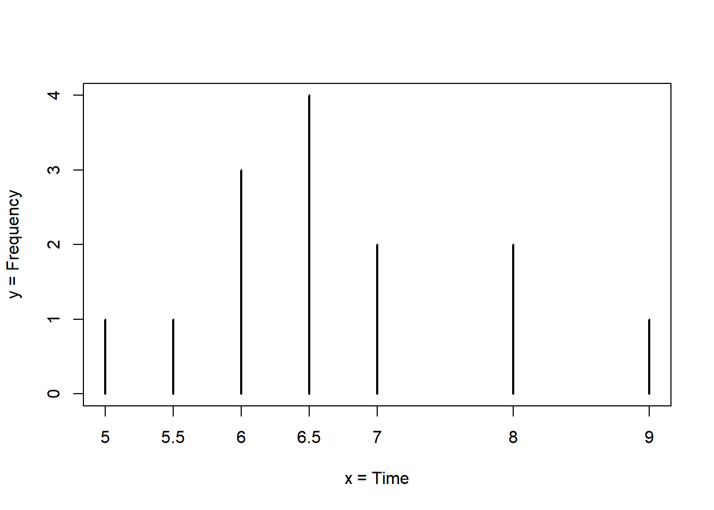
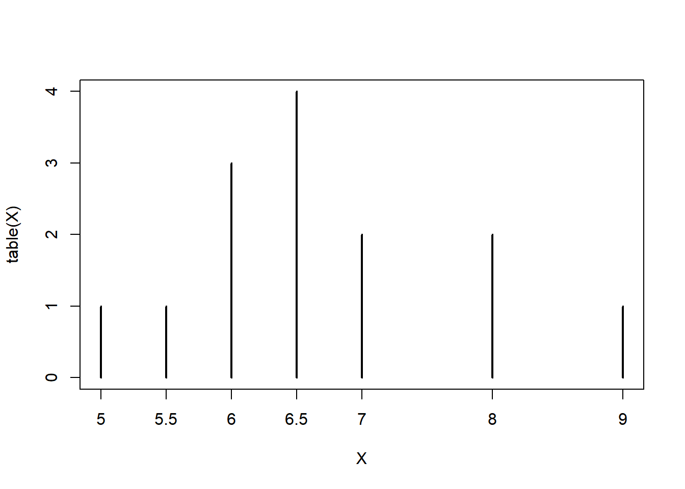

[← Back to portfolio](../index.md)

*Published 2022-06-11 · Originally on [RPubs](https://rpubs.com/kambonalytic/913699) · Data: [Statistical Thinking datasets](http://pluto.huji.ac.il/~msby/StatThink/)*

## Statistics

The science of statistics deals with the collection, analysis, interpretation, and presentation of data. We see and use data in our everyday lives.

Below is an example how data is presented in statistics.



*Frequency of Average Time (in Hours) Spent Sleeping per Night*

### Some Basic `R` Commands

```r
setwd("C:/Users/.../IntroStat")# This set the directory point to the folder where the datasets are located or where any output will be saved

# Remmember that the expression "C:/Users/.../IntroStat" is know as the path. Use the function getwd() to see where the directory used by your R session
# Then take the output from getwd() and modify it to reflect the directory you want to use and use setwd(...) to set the new directory
```

```r
#Type in the R-Console panel, immediately after the “>” prompt, the expression “1+2
#The prompt “>” indicates that the system is ready to receive commands.
1 + 2
```

```text
## [1] 3
```

```r
c(5,5.5,6,6,6,6.5,6.5,6.5,6.5,7,7,8,8,9) #The function “c” is an example of an R 
```

```text
##  [1] 5.0 5.5 6.0 6.0 6.0 6.5 6.5 6.5 6.5 7.0 7.0 8.0 8.0 9.0
```

```r
#We call the components of the input the arguments of the function. 
#Arguments are separated by commas. A function produces an output, which is typically an R object.
#In the current example an object of the form of a sequence was created and, 
#according to the default application of the system, was sent to the screen and not saved.
```

```r
# If we want to create an object for further manipulation then we should save it and give it a name. 

X <- c(5,5.5,6,6,6,6.5,6.5,6.5,6.5,7,7,8,8,9)

# The arrow that appears after the “X” is produced by typing the less than key “<” followed by the minus key “-”. 

#This arrow is the assignment operator.

#Notice that no output was sent to the screen. 

#Instead, the output from the “c” function was assigned to an object that has the name “X”. 
```

```r
# A new object by the given name was formed and it is now available for further analysis.

# In order to verify this you may write “X” at the prompt and hit return:
X
```

```text
##  [1] 5.0 5.5 6.0 6.0 6.0 6.5 6.5 6.5 6.5 7.0 7.0 8.0 8.0 9.0
```

```r
#If we want to produce a table that contains a count of the frequency of the different values in our data we can apply the function “table” to the object #“X” (which is the object that contains our data)
table(X)
```

```text
## X
##   5 5.5   6 6.5   7   8   9 
##   1   1   3   4   2   2   1
```

```r
#Notice that the output of the function “table” is a table of the different levels of the input vector and the frequency of each level. 

#This output is yet another type of an object.
```

```r
#The bar-plot can be produced by the application of the function “plot” to the object that is produced as an output of the function “table”:

plot(table(X))
```



### `R` functions introduced in this chapter

- `setwd(dir)` is used to set the working directory to `dir`.
- `c()` is a generic function which combines its arguments.
- `save(..., file)` writes `R` objects to the specified file.
- `load()` reloads datasets written with the function save.
- `rm()` can be used to remove objects.
- `table()` constructs a table of counts of the different values.
- `plot()` is a generic function for plotting of `R` objects.
