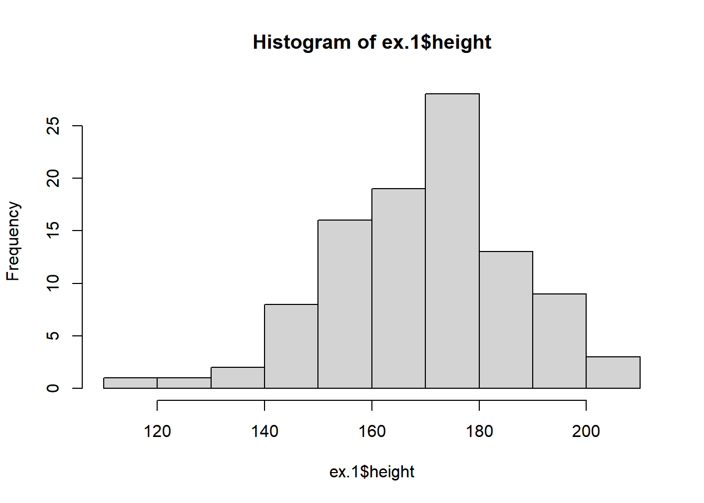
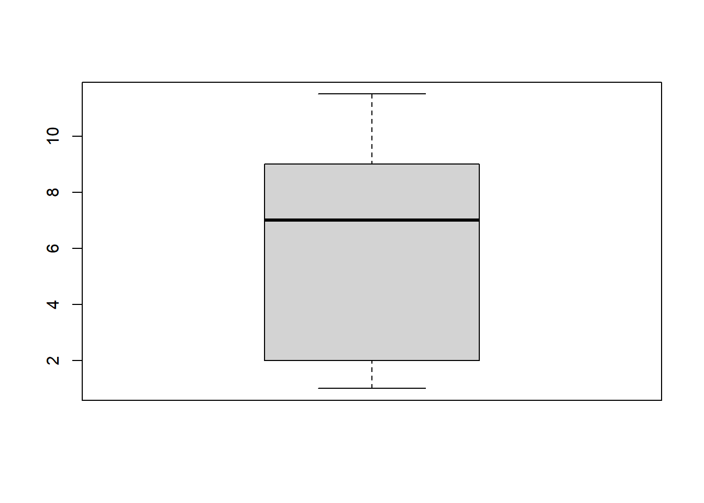
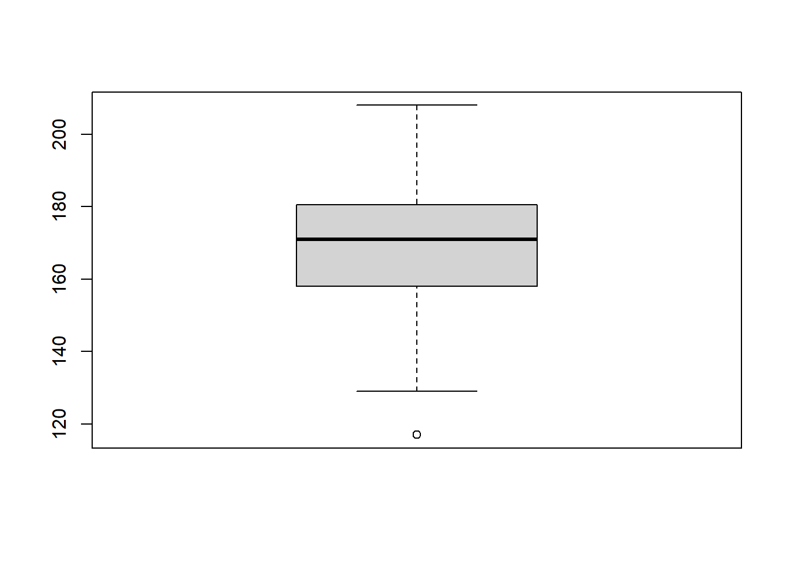
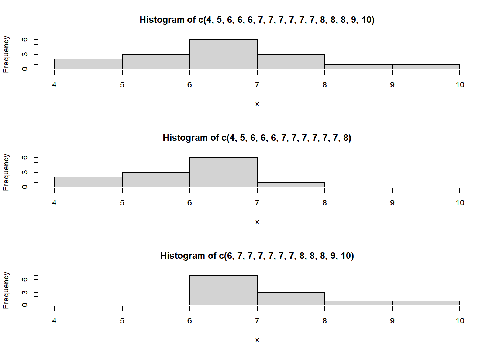

[← Back to portfolio](../index.md)

*Published 2022-06-12 · Originally on [RPubs](https://rpubs.com/kambonalytic/914003) · Data: [Statistical Thinking datasets](http://pluto.huji.ac.il/~msby/StatThink/)*

## Histograms

```r
#The *histogram* is a frequently used method for displaying the
#distribution of continuous numerical data. 
#An advantage of a histogram is that it can readily display large data sets. 
#A rule of thumb is to use a histogram when the data set consists of 100 values or more.

ex.1 <- read.csv("http://pluto.huji.ac.il/~msby/StatThink/Datasets/ex1.csv")

hist(ex.1$height)
```



*Histogram of Height*

```r
ex.1$height # This list the input used to construct the histogram
```

```text
##   [1] 182 168 172 154 174 176 193 156 157 186 143 182 194 187 171 178 157 156
##  [19] 172 157 171 164 142 140 202 176 165 176 175 170 169 153 169 158 208 185
##  [37] 157 147 160 173 164 182 175 165 194 178 178 186 165 180 174 169 173 199
##  [55] 163 160 172 177 165 205 193 158 180 167 165 183 171 191 191 152 148 176
##  [73] 155 156 177 180 186 167 174 171 148 153 136 199 161 150 181 166 147 168
##  [91] 188 170 189 117 174 187 141 195 129 172
```

## Box Plots

```r
# One may produce a box plot with the aid of the function “boxplot”. 
# The input to the function is a sequence of numerical values and the output is a plot. 
boxplot(c(1,11.5,6,7.2,4,8,9,10,6.8,8.3,2,2,10,1))
```



```r
boxplot(ex.1$height) # This produce the boxplot of the height data
```



```r
summary(ex.1$height) # The summary function will help us assess the plot by computing quartiles
```

```text
##    Min. 1st Qu.  Median    Mean 3rd Qu.    Max. 
##   117.0   158.0   171.0   170.1   180.2   208.0
```

## Skewness, the Mean and the Median



*Three Histograms*

```r
x <- c(4,5,6,6,6,7,7,7,7,7,7,8,8,8,9,10)
mean(x)
```

```text
## [1] 7
```

```r
median(x)
```

```text
## [1] 7
```

```r
#The mean and the median are each 7 for these data. 
#In a perfectly symmetrical distribution, the mean and the median are the same
```

```r
x <- c(4,5,6,6,6,7,7,7,7,7,7,8)
mean(x)
```

```text
## [1] 6.416667
```

```r
median(x)
```

```text
## [1] 7
```

```r
#The median is still 7, but the mean is less than 7.
#The relation between the mean and the median reflects the skewing.
```

```r
x <- c(6,7,7,7,7,7,7,8,8,8,9,10)
mean(x)
```

```text
## [1] 7.583333
```

```r
median(x)
```

```text
## [1] 7
```

```r
#The median is yet again equal to 7, but this time the mean is greater
#than 7. Again, the mean reflects the skewing.

#In summary, if the distribution of data is skewed to the left then the
#mean is less than the median. If the distribution of data is skewed to
#the right then the median is less than the mean.
```

```r
# We examine the data on the height in “`ex.1`"
mean(ex.1$height)
```

```text
## [1] 170.11
```

```r
median(ex.1$height)
```

```text
## [1] 171
```

```r
x <- c(9,9.5,9.5,10,10,10,10,10.5,10.5,10.5,10.5,11,11,11,11,11,11,11.5,11.5,11.5)

length(x) # The function “length” returns the length of the input sequence
```

```text
## [1] 20
```

```r
# Steps in the computation of the deviations:

x.bar <- mean(x)
x.bar
```

```text
## [1] 10.525
```

```r
x - x.bar
```

```text
##  [1] -1.525 -1.025 -1.025 -0.525 -0.525 -0.525 -0.525 -0.025 -0.025 -0.025
## [11] -0.025  0.475  0.475  0.475  0.475  0.475  0.475  0.975  0.975  0.975
```

```r
# Steps in the computation of the squares of the deviation

(x - x.bar)^2
```

```text
##  [1] 2.325625 1.050625 1.050625 0.275625 0.275625 0.275625 0.275625 0.000625
##  [9] 0.000625 0.000625 0.000625 0.225625 0.225625 0.225625 0.225625 0.225625
## [17] 0.225625 0.950625 0.950625 0.950625
```

```r
# For the variance we sum the square of the deviations and divide by the
#total number of data values minus one ($n-1$). 
#The standard deviation is obtained by taking the square root of the variance

sum((x - x.bar)^2)/(length(x)-1)
```

```text
## [1] 0.5125
```

```r
sqrt(sum((x - x.bar)^2)/(length(x)-1))
```

```text
## [1] 0.7158911
```

```r
# If the variance is produced as a result of dividing the sum of squares
# by the number of observations minus one then the variance is called the
# *sample variance*
```

```r
var(x) # The function “`var`" computes the sample variance
```

```text
## [1] 0.5125
```

```r
sd(x) # the function “`sd`" computes the standard deviations
```

```text
## [1] 0.7158911
```
