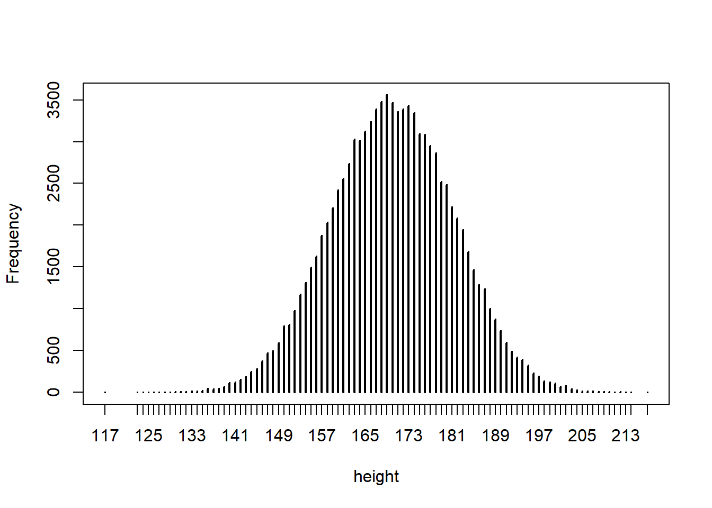

[← Back to portfolio](../)

*Published 2022-06-19 · Originally on [RPubs](https://rpubs.com/kambonalytic/916316) · Data: [Statistical Thinking datasets](http://pluto.huji.ac.il/~msby/StatThink/)*

## A Population

```r
#This section introduce the variability of a population and present
#some numerical summaries that characterizes this variability.

ex.1 <- read.csv('http://pluto.huji.ac.il/~msby/StatThink/Datasets/ex1.csv')
summary(ex.1)
```

```text
##        id              sex                height     
##  Min.   :1538611   Length:100         Min.   :117.0  
##  1st Qu.:3339583   Class :character   1st Qu.:158.0  
##  Median :5105620   Mode  :character   Median :171.0  
##  Mean   :5412367                      Mean   :170.1  
##  3rd Qu.:7622236                      3rd Qu.:180.2  
##  Max.   :9878130                      Max.   :208.0
```

```r
# when applied to a numeric sequence, the function “`summary`" produces the smallest and largest values in the
# sequence, the three quartiles (including the median) and the mean.

# If the input of the same function is a factor then the outcome is the
# frequency in the data of each of the levels of the factor.

# when the input to the function “`summary`" is a data frame,
# as is the case in this example, then the output is a summary of each of
# the variables of the data frame.
```

```r
pop.1 <- read.csv('http://pluto.huji.ac.il/~msby/StatThink/Datasets/pop1.csv')
summary(pop.1)
```

```text
##        id              sex                height   
##  Min.   :1000082   Length:100000      Min.   :117  
##  1st Qu.:3254220   Class :character   1st Qu.:162  
##  Median :5502618   Mode  :character   Median :170  
##  Mean   :5502428                      Mean   :170  
##  3rd Qu.:7757518                      3rd Qu.:178  
##  Max.   :9999937                      Max.   :217
```



*Bar Plot of Height*

## Random Variables

```r
# The object `pop.1$height` is a sequence with 100,000 entries. Think of
# it as a population. We will apply the function “`sample`" to this sequence

sample(pop.1$height,1)
```

```text
## [1] 166
```

```r
# When we set the second argument to 1 then the function selects one of the
# entries of the sequence at random, with each entry having the same likelihood of being selected.
# Each time the function above is run, a different result if going to be obtained randomly
```

### Sample Space and Distribution

```r
# The random person can be any of the subjects of the population with equal probability.

pop.1 <-  read.csv('http://pluto.huji.ac.il/~msby/StatThink/Datasets/pop1.csv')
X <- pop.1$height
```

```r
mean(abs(X-170) <= 10)
```

```text
## [1] 0.64541
```

```r
# We get that the height of a person randomly sampled from the population is between 160 and 180 centimeters with probability 0.64541.
```
